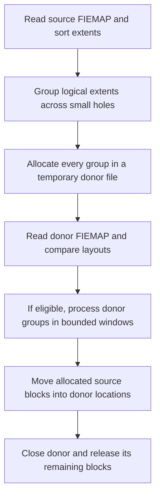

# e4defrag donor grouping, holes, and alignment

This describes `defrag-mergesort` at `ff644041`, following the October 2026
bug fixes. It also records a first architecture review and proposed controls.
The proposals below are **not implemented command-line options**.

The fixes preserved the existing donor allocation policy. They changed how
the program sorts extents, handles errors, measures progress, and processes
large allocated groups. They did not add RAID detection, redesign the hole
policy, or establish the best layout for a database workload.

## Four different sizes

| Quantity | Current behavior | Purpose |
| --- | --- | --- |
| Hole threshold | Join across gaps smaller than 8 filesystem blocks | Decide which source extents belong in one allocation request |
| Donor allocation length | Span of the group, including its small holes; no explicit group-size cap | Give ext4 a larger allocation request |
| Allocation-length padding | Disabled; experimental `ALIGN` rounds selected lengths to 64 KiB | Try a different request shape for the allocator |
| Move window | At most 64 MiB, reduced on `ENOMEM` | Bound address-space use during cache inspection and extent movement |

With 4 KiB blocks, the hole policy includes gaps of up to **7 blocks / 28 KiB**;
a gap of exactly 8 blocks / 32 KiB starts a new group. Neither that threshold
nor the 64 KiB padding constant is derived from the RAID geometry.

A logical extent describes a range within a file and its physical backing.
A group here is a span of **logical file offsets**. It can contain several
physical extents, including extents that are far apart on disk. One
`fallocate()` call does not imply one physically contiguous allocation.

## Current path through the code

The implementation is in [misc/e4defrag.c](../misc/e4defrag.c).

1. `get_file_extents()` reads FIEMAP and sorts by physical position.
   `change_physical_to_logical()` sorts the same nodes by logical position.
2. `join_extents()` groups adjacent logical extents and bridges gaps of 1–7
   blocks. The group's length includes those gaps. Physical continuity is
   not a condition. Leading and trailing holes outside the first and last
   extents are not added to the group.
3. `file_defrag()` creates a donor beside the source, unlinks its pathname,
   and keeps its descriptor open. For each source group it calls
   `fallocate(donor_fd, 0, group_start * block_size, group_length * block_size)`.
   All groups are allocated before any source extents are moved.
4. It reads the donor's actual extent map, computes its continuous-region
   count, and groups its logical extents again. One donor allocation request
   can have produced several physical extents; regrouping them can therefore
   create a very large processing group.
5. Normally, the program skips files at its estimated best extent count and
   donors whose continuous-region count is no better than the source's.
   `get_physical_count()` requires continuity in **both** logical and physical
   offsets. `get_best_count()` uses block-group/flex-group geometry, not RAID
   stripe geometry. These counts are heuristics, not performance measurements.
6. `call_defrag()` processes at most 64 MiB of a donor group at a time. It
   inspects cached pages using `mmap64()`/`mincore()`, issues `EXT4_IOC_MOVE_EXT`,
   and performs cache cleanup. Source and donor logical offsets match.
7. Closing the unlinked donor releases the blocks still owned by it, including
   the source's old blocks received during exchanges.

An individual group can still span an entire densely allocated file. The
64 MiB processing cap does **not** divide its initial `fallocate()` request.

## What happens to a small hole

Suppose the source has these logical block ranges, using half-open intervals:

| Range | Source contents | Donor request |
| --- | --- | --- |
| `[0, 10)` | Data A | First group |
| `[10, 13)` | Hole of 3 blocks | Included in first group |
| `[13, 23)` | Data B | First group |
| `[23, 100)` | Hole of 77 blocks | Left out |
| `[100, 110)` | Data C | Second group |

The allocation requests cover `[0, 23)` and `[100, 110)`. If ext4 happens to
place the first request contiguously, A and B can acquire nearby physical
locations with a three-block gap between them. That is the intended placement
opportunity. Their logical hole still prevents them from becoming a single
logical extent.

The kernel skips holes in the **source** when moving extents. The donor's
allocation over `[10, 13)` therefore remains in the donor and is released on
close. The source still has a hole; it does not own a reservation for future
writes there. Other files can subsequently use that freed space. This follows
from the source-hole handling in
[Linux v7.0 `ext4_move_extents()`](https://github.com/torvalds/linux/blob/v7.0/fs/ext4/move_extent.c).

A true hole and allocated-but-unwritten space both read as zeros, but only the
latter owns blocks. Reserving future database capacity requires a separate
preallocation policy on the original file, with different space accounting
and sparse-file behavior. If an application later punches a hole, it releases
that allocation again. See the allocation and hole-punch semantics in
[`fallocate(2)`](https://man7.org/linux/man-pages/man2/fallocate.2.html).

Thus, “allocate the whole donor once” and “reserve the whole database for
future writes” are separate features. The former cannot provide the latter
through the existing hole-preserving move operation.

## What the October fixes changed

| Area | Fix | Allocation policy affected? |
| --- | --- | --- |
| List sorting | Natural node alignment, compatible const comparator, removal of obsolete helpers, propagated allocation errors | No |
| Sparse progress | Compare byte offsets with `st_size`, use logical ranges for completion | No |
| Large groups | Bound cache mappings and moves; use 64-bit mapping offsets | No change to donor allocation requests |
| Memory pressure | Halve the processing window on `ENOMEM`, down to one filesystem block | No; donor space has already been allocated |
| Debug builds | Share the requested length between normal and `ALIGN` builds; guard diagnostic-only variables | Existing padding formula preserved |

`moved_len` counts blocks actually moved and excludes holes. After a successful
operation, progress advances through the requested logical range. Using
`moved_len` as a logical offset would confuse sparse-file holes with unfinished
work. The kernel implementation linked above distinguishes these quantities.

There is still **no userspace donor-allocation retry policy**: if `fallocate()`
fails, processing that file stops and the donor is closed. Fragmented free
space can instead produce a successful but fragmented allocation; allocation
success does not establish that the requested placement was obtained.

## The existing alignment experiment

`ALIGN` is a compile-time switch, disabled in the checked-in source. When
enabled, it rounds a group's requested length upward to a multiple of 65,536
bytes, provided that the source has `st_blocks > 16` and this is not the last
source group. It does not round the group's starting logical offset.

The `st_blocks` condition means more than 16 **512-byte allocation units**
(8 KiB allocated), not more than one 64 KiB stripe. Padding can extend a donor
request into a gap between source groups. These are existing behaviors to
review before turning the experiment into a supported runtime policy.

For example, rounding a request's length to 64 KiB does not make its starting
address divisible by 64 KiB. Nor does the program choose a physical address:
`fallocate()` supplies a file offset and length, and ext4 chooses the backing
blocks. The name “allocation-length padding” describes what this code does
more accurately than a promise of physical alignment.

Linux can already use configured RAID geometry. In v7.0,
[`ext4_get_stripe_size()`](https://github.com/torvalds/linux/blob/v7.0/fs/ext4/super.c)
selects a valid mount `stripe=` value, then the superblock stripe width, then
the stride, subject to validity checks. The
[`mballoc` implementation](https://github.com/torvalds/linux/blob/v7.0/fs/ext4/mballoc.c)
contains a stripe-aligned search for suitable requests and can fall back to
other searches. Padding may influence those decisions; it does not guarantee
their result. The [ext4 mount documentation](https://www.kernel.org/doc/html/latest/admin-guide/ext4.html)
defines `stripe=` in filesystem blocks. Kernel versions and storage layers
can change the details, so actual placement needs FIEMAP verification.

## What exists for RAID geometry

I searched `misc/e4defrag.c` across all locally available Git refs. The
recorded fork history contains the fixed eight-block hole rule and the
64 KiB padding experiment, but no stripe/stride autodetection in e4defrag.
This does not rule out uncommitted experiments or another checkout.

| Historical commit | Relevant change |
| --- | --- |
| [`dc16f194`](https://github.com/Donwulff/e2fsprogs/commit/dc16f194) | Process joined donor extents, September 2020 |
| [`4a9e5664`](https://github.com/Donwulff/e2fsprogs/commit/4a9e5664) | Include holes smaller than eight blocks, September 2020 |
| [`620f6671`](https://github.com/Donwulff/e2fsprogs/commit/620f6671) | Add the 64 KiB padding experiment, September 2024 |
| [`7c5699af`](https://github.com/Donwulff/e2fsprogs/commit/7c5699af) | Put padding behind `ALIGN` and correct rounding |
| [`a55bc0d6`](https://github.com/Donwulff/e2fsprogs/commit/a55bc0d6) | Avoid padding the last group; rename `ALWAYS` to `SHAKE` |

There is reusable topology-reading code elsewhere in this repository:
[`mke2fs.c`](../misc/mke2fs.c), in `get_device_geometry()`, reads minimum and
optimal I/O sizes and alignment offset through libblkid. The filesystem
creation path can translate those into `s_raid_stride` and
`s_raid_stripe_width`. e4defrag currently reads only block-group/flex-group
information from the superblock for its best-count heuristic.

The [mke2fs manual](../misc/mke2fs.8.in) distinguishes per-disk chunk/stride
from full data-stripe width. For a RAID5 example with four drives, a 64 KiB
chunk and 4 KiB filesystem blocks imply stride 16 and data-stripe width 48
blocks (192 KiB). The 64 KiB constant is not a universal full-stripe size.

A future detector should report the filesystem metadata, effective mount
configuration, and device topology separately, including their units and
sources. Unknown or conflicting values need to remain visible. Stacked
devices, partition offsets and the alignment of logical application writes
also matter; a single size value does not describe every alignment constraint.
The current `block_size` initialization uses the target's `st_blksize`, so
geometry work should also validate actual filesystem block size rather than
treating preferred I/O size as RAID geometry.

## Runtime controls worth adding

The executable currently accepts only `-c` (statistics) and `-v` (verbosity).
`ALIGN`, `SHAKE`, `NOLOCK`, `DEBUG`, and `DEBUG2` are compile-time switches.
`SHAKE` relaxes equality checks; it does not unconditionally accept a worse
donor. `NOLOCK` bypasses the advisory-lock query. There is no automatic SSD
exclusion in this program; target selection is the caller's responsibility.

The following is a proposed interface, not accepted syntax today:

| Proposed control | Initial default | Meaning |
| --- | --- | --- |
| `--max-hole-blocks=N` | `7` | Inclusive largest gap to bridge; `0` groups only logically adjacent extents |
| `--move-window=SIZE` | `64MiB` | Bound processing memory independently of donor allocation; initially allow smaller block-aligned limits |
| `--allocation-padding=off\|SIZE` | `off` | Explicit length padding; requires defined gap/EOF limits before implementation |
| `--allow-equal-layout` | Disabled | Runtime equivalent of the existing `SHAKE` comparison policy |
| `--show-geometry` | Disabled | Report detected values, effective policy and unresolved geometry |

The first two controls are a small, separable implementation. Preserve the
current defaults, reject invalid/overflowing sizes, define rounding in
filesystem blocks, and test gap boundaries and low-memory retries. Do not
silently derive the hole threshold from stripe width: locality and temporary
space consumption are different policy choices.

Keep a future `--stripe-width` override distinct from padding. An e4defrag-local
override would only guide its request planning; it would not change the
mounted kernel allocator's `stripe=` setting. A true alignment policy needs a
defined physical/logical origin and measured post-allocation results.

## Remaining design questions and validation

These are review findings and follow-up work, not changes made by this document:

- **Temporary space:** the existing preflight counts source allocated blocks,
  but grouped donor requests include holes and optional padding. All donor
  groups coexist before movement. A planner should account for that extra
  space and set a budget before offering larger-hole or whole-file policies.
- **Retry semantics:** an `ENOMEM` mapping retry is now implemented. An
  `ENOSPC` allocation fallback would need cleanup of possibly partially
  allocated donor ranges and a defined policy for dropping padding or
  splitting groups. Retrying smaller requests cannot create missing space.
- **Layout quality:** compare original and resulting FIEMAP maps, including
  gap distances and the same logical data ranges. A donor-region count that
  includes filled holes is only a candidate-selection heuristic. Measure
  actual read performance and allocator cost before changing defaults.
- **Database growth:** preserving holes and retaining capacity reservations
  have different semantics. Decide that policy with the application's
  allocation/punching behavior in view.

The [existing regressions](../misc/test_e4defrag.c) verify sparse ranges,
bounded mappings and failure handling using mocked extent-moving ioctls.
They do not establish physical placement. The next architecture tests should
use a disposable mounted ext4 volume: verify data hashes, source holes and
FIEMAP maps before/after; exercise 7- versus 8-block gaps, constrained free
space, padding boundaries, and different recorded stripe geometries. Compare
cached and uncached workloads separately. A stripe-aware default needs those
measurements in addition to parser and bookkeeping tests.

## Clarification about the code-quality workflows

The scanner templates were fork additions from October 2021. The recent
workflow work kept and repaired CodeQL and the compiler/test/sanitizer CI.
It removed the Sysdig container, Snyk IaC, StackHawk web, Veracode and Synopsys
templates because they lacked usable project-specific targets or configuration.
Those services were not made operational. Their definitions remain in Git
history if a real integration is wanted later.
